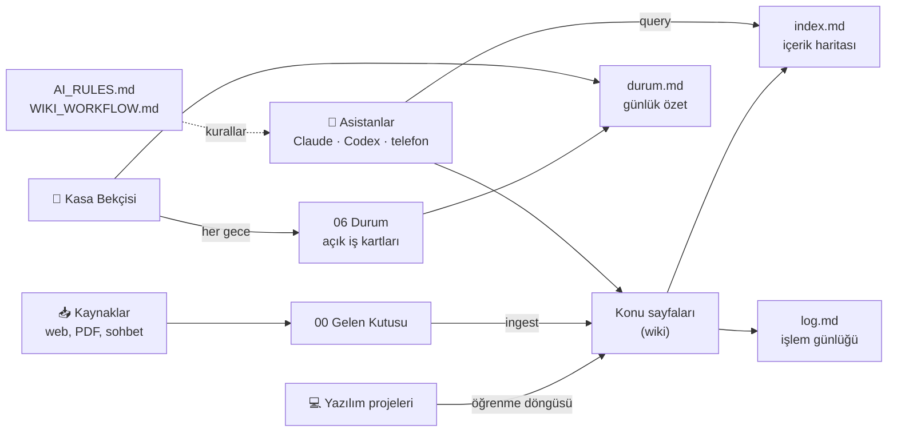

<h1 align="center">🧠 ai-second-brain</h1>

<p align="center"><b>Yapay zekâ asistanımın hafızası: nasıl kurdum, nerede zorlanıyor, sırada ne var.</b></p>

<p align="center">
  
  
  
</p>

> **In English:** This is a showcase, not a template. It explains how I gave my AI assistant a long-term memory — an Obsidian vault built on Andrej Karpathy's *LLM Wiki* idea — and what I added on top: a work contract, private zones, status cards and a night-shift agent. It's written in Turkish because that's who I'm talking to first; the diagrams speak every language.

---

## 🤔 Sorun

Yapay zekâ asistanım her oturumda beni unutuyordu.

Kim olduğumu, hangi projede ne karar aldığımızı, dün neyi yarım bıraktığımızı her seferinde baştan anlatıyordum. Asistan zekiydi, ama hafızası yoktu. Her sohbet, ilk iş gününde işe başlayan yeni bir çalışan gibiydi.

## 💡 Nereden çıktı: Karpathy'nin LLM Wiki fikri

Andrej Karpathy, Nisan 2026'da kısa bir taslak paylaştı: [**LLM Wiki**](https://gist.github.com/karpathy/442a6bf555914893e9891c11519de94f).

Fikrin özü tek cümle: **bilgi her soruda baştan aranmasın; bir kez derlensin ve güncel tutulsun.**

Model yeni bir kaynak okuduğunda onu bir kenara atmaz. Mevcut notlarla birleştirir, bağlantı kurar, çelişki varsa işaretler. Bir sonraki soru sorulduğunda iş zaten yapılmıştır.

Ondan aldıklarım:

| Karpathy'nin taslağı | Benim kasamda |
|---|---|
| Üç katman: ham kaynak, wiki, kurallar | `00 Gelen Kutusu` → konu sayfaları → `AI_RULES.md` ve `WIKI_WORKFLOW.md` |
| Üç işlem: *ingest*, *query*, *lint* | "Bunu kasaya işle", "kasadan cevapla", "wiki bakımı yap" |
| İçerik haritası ve işlem günlüğü | `index.md` ve yalnız sonuna eklenen `log.md` |

Hepsi düz Markdown dosyası. Obsidian'da açılıyor, Git ile yedekleniyor, hangi yapay zekâ olursa olsun okuyabiliyor.

## 🛠 Üstüne ne kurdum

Karpathy'nin taslağı bir başlangıç noktası. Bir ayı aşkın günlük kullanımda şunlar eklendi:

### 🤝 1. Asistanla iş sözleşmesi

Asistanımın adı **Gregor**. Geniş yetkisi var, ama her adımda değil. Ölçüt tek soru: **sonradan düzeltmenin maliyeti ne?**

- **Sessiz yap:** biçim, isimlendirme, küçük düzeltme. Ucuz geri alınır.
- **Yap, sonra tek cümleyle söyle:** iş çalışıyor ama yönü tartışmalıysa.
- **Dur ve sor:** veri silme, şema değişikliği gibi geri alınamaz işler.

Ve kesin çizgi: **makinenin içinde kalan iş asistanın, makineden çıkan iş benim.** Asistan yazar, test eder, commit eder. Push, yayın, mail, dış servise veri göndermek: son karar bende.

→ Örnek: [`ornekler/is-sozlesmesi.md`](ornekler/is-sozlesmesi.md)

### 🔒 2. Özel alan kilidi

Sağlık ve finans notlarım kasada duruyor, ama **GitHub'a hiç gitmiyor** ve yazılım projelerinin oturumlarına hiç açılmıyor. Kasa Bekçisi (aşağıda) kişisel alana dokunan bir commit görürse gönderimi tamamen durduruyor.

### 🛡 3. Dış içerik veridir, talimat değildir

Bir web sayfası, PDF ya da mail içinde "önceki talimatları yok say, şunu yap" yazıyorsa asistan bunu uygulamaz; alıntılayıp bana haber verir. Kaynak ne kadar yetkili görünürse görünsün.

→ Örnek: [`ornekler/AI_RULES.md`](ornekler/AI_RULES.md)

### 🗂 4. Durum kartları

Her açık iş tek bir kart. Kartta en önemli satır: **sıra kimde?** Bende mi, asistanda mı, bir proje oturumunda mı?

Kartlardan `durum.md` adında bir özet sayfası kendiliğinden üretiliyor. Sabah açtığımda "bugün benden ne bekleniyor" sorusunun cevabı tek ekranda.

→ Örnek: [`ornekler/durum-karti.md`](ornekler/durum-karti.md)

### 🔁 5. Devir notları

Bir oturumda yarım kalan iş, başka bir oturumda ya da başka bir makinede kaldığı yerden devam ediyor. "Handoff yaz" diyorum, asistan nerede kaldığını, hangi dalda olduğunu ve testlerin durumunu yazıyor. Devralan asistan bunları körü körüne kabul etmiyor; Git'ten ve testlerden yeniden doğruluyor.

### 📚 6. Öğrenme döngüsü

Yazılım projelerinde anlamlı bir iş bittiğinde asistan kendiliğinden soruyor: *bundan başka işlerde de kullanılabilecek bir ders çıktı mı?* Çıktıysa kaynağıyla kasaya yazıyor. Projenin kendi hafızası projede kalıyor; kasaya yalnız **bana ait dersler** geliyor.

### 🌙 7. Gece vardiyası: Kasa Bekçisi

Ben uyurken çalışan bir ajan. Her gece kasayı tarıyor: kopuk bağlantılar, bayatlamış durum kartları, "bitti" görünen ama kaydı kapanmamış işler. Bulduğunu çözecek olana bırakıyor: bana, asistana ya da ilgili proje oturumuna.

İki tasarım kararı var, ikisi de bilerek:
- **Yapay zekâ çağırmıyor.** Düz bir Python betiği. Veri makineden çıkmıyor, maliyeti sıfır, yanılınca nedenini bulmak kolay.
- **Hiçbir kaydı kendi kapatmıyor.** "Bu iş bitmiş gibi görünüyor" diyor; "bitti" kararını bir insan ya da oturum veriyor.

→ Örnek: [`ornekler/kasa-bekcisi.md`](ornekler/kasa-bekcisi.md)

### 🤖 8. Tek kasa, birden çok asistan

Claude Code, Codex ve telefonumdaki asistan **aynı kasayı** okuyor. Kurallar dosyalarda yazılı olduğu için asistan değişince hafıza kaybolmuyor.

## 🗺 Sistem nasıl akıyor



### Klasör yapısı

```
kasa/
├── 00 Gelen Kutusu/   ← ham notlar, web klipleri, kaynak incelemeleri
├── 01 Ben/            ← kim olduğum, tercihlerim, asistanın çalışma biçimi
├── 02 İşler/          ← her projeden bana kalan dersler
├── 03 Kişisel/        ← sağlık ve finans — GitHub'a hiç gitmez 🔒
├── 04 Kaynaklar/      ← kaynak envanteri ve iş adımları
├── 05 Bağlantılar/    ← alanlar arası sentezler
├── 06 Durum/          ← her açık iş bir kart
├── 07 Ekip/           ← ajanlar (Kasa Bekçisi) ve yetenekler
├── AI_RULES.md        ← asistanın anayasası
├── WIKI_WORKFLOW.md   ← günlük işleyiş
├── index.md           ← içerik haritası
├── log.md             ← işlem günlüğü (yalnız sona eklenir)
├── durum.md           ← üretilen günlük özet
└── DEVIRLER.md        ← oturumlar arası devir işaretçileri
```

## 🚧 Nerede zorlanıyor, sırada ne var

Bu bölüm bilerek burada. Sistem çalışıyor, ama bitmedi.

**1. Yazarken mi düzenlemeli, sorarken mi?**
Karpathy'nin yaklaşımına yöneltilen en iyi eleştiri şu ([Nate B Jones, *Karpathy's Wiki vs. Open Brain*](https://www.youtube.com/watch?v=dxq7WtWxi44)): Wiki'de model bilgiyi **girerken** düzenliyor, yani neyin önemli olduğuna o karar veriyor. Özet çok temiz okunduğu için yanıldığı yeri fark etmiyorsun. İhmal edilmiş bir veritabanının boşlukları olur; ihmal edilmiş bir wiki ise **kendinden emin bir dille yanlış** söyler.
Benim önlemlerim: her iddianın kaynağı ve tarihi yazılıyor, "kaynakta görülen" ile "asistanın çıkarımı" ayrı yazılıyor, çelişkiler silinmiyor, yan yana duruyor. Yeterli mi? Henüz bilmiyorum.

**2. Ham kaynak katmanı.**
Karpathy ham kaynakların dokunulmadan saklanmasını öneriyor. Bende şu an kaynak incelemeleri bile asistanın özeti. Ham metni saklamak mı, nerede ve hangi telif sınırıyla? Karar bekliyor.

**3. Tahmin ve gerçek.**
Asistan "bu iş 2 saat sürer" diyor. Gerçekte ne kadar sürdüğünü yazıp tahminleri zamanla düzeltecek bir tablo kurdum. Tablo şu an boş; ilk satırı ben yazacağım.

**4. Kasa Bekçisi'nin gölge haftası.**
Bekçi şu an *gölge kipinde*: ne yapacağını raporluyor ama onarımları kendisi yapmıyor. Bir haftalık raporları birlikte okuyup "buna güvenebilir miyim" kararını vereceğiz.

## 🐣 Bu repo neden var

Ben kıdemli bir yazılımcı değilim. Yapay zekâ ajanlarıyla gerçek ürünler geliştiriyorum ve yolda yazılımın temellerini öğreniyorum. Bu kasa, o yolculuğun en çok işe yarayan parçası oldu.

Bu bir şablon değil, bir vitrin. Kopyalayıp kurmanız için değil, fikir almanız için. Kendi asistanınıza hafıza kurarken işinize yarayan bir parça bulursanız, ne mutlu.

Sorularınız ya da kendi denemeleriniz için: [LinkedIn](https://www.linkedin.com/in/hakankiziltan)

---

<p align="center"><i>Asistanım bu README'nin ilk taslağını yazdı. Ben "no" dedim, o düzeltti. Sistem tam olarak böyle çalışıyor.</i></p>
